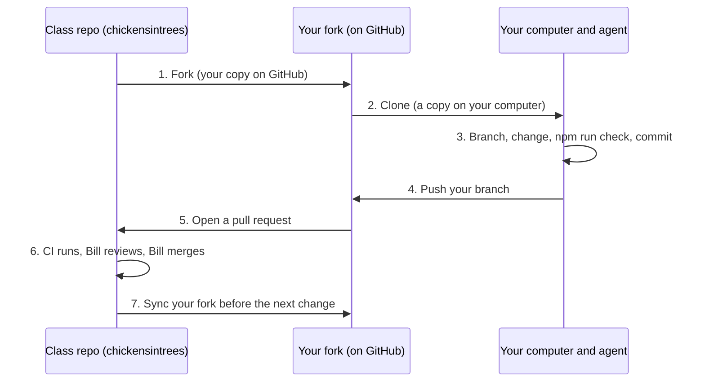

# GitHub basics

Eleven words, one sentence each. Once your agent is connected to GitHub, it does
the git for you. You still need the words to follow along and to decide.

| Word | What it means |
|---|---|
| **Repository (repo)** | A project's folder of files plus its full history, stored on GitHub (the class repo is `chickensintrees/agentic-marketing-toolkit`). |
| **Fork** | Your own copy of someone else's repository, on your GitHub account, that you can change freely. |
| **Clone** | A copy of a repository on your computer (or in your tool's cloud workspace), linked back to GitHub. |
| **Branch** | A separate line of work inside a repository, so one change stays apart from `main` and from your other changes. |
| **Commit** | A saved snapshot of your changes, with a short message saying what changed. |
| **Push** | Sending your commits from your computer up to GitHub, to your fork. |
| **Pull** | Bringing the latest commits from GitHub down to your computer. |
| **Pull request (PR)** | A request to the class repo: "please pull the changes on my branch into `main`", with a description and a place to discuss them. |
| **Review** | Comments on a pull request, from people or agents, asking questions or requesting changes before it is merged. |
| **Merge** | Combining a pull request's changes into `main`, which here only Bill does, and which updates the live site. |
| **Issue** | A numbered to-do, bug report, question or idea on GitHub, where one issue is one piece of work. |

Two more you'll see: **`origin`** is your fork (where you push) and
**`upstream`** is the class repo (where your pull request goes). **CI** is the
set of automated checks that run on every pull request.

## How a contribution flows

In words: you **fork** once and **clone** your fork. For each change you make
a **branch**, **commit**, **push** it to your fork, and open a **pull request**
to the class repo. Checks run, Bill **reviews**, and when it's ready, he
**merges** it. Then you **sync** your fork and start the next one.

## Your agent does the git

Once your agent is [connected to GitHub](students/connect-github.md), you
can say "fork the project", "commit this", "push it" or "open the pull
request", and it runs the commands. It should explain each one and wait for
your OK before anything public.

**You approve yourself:** the fork, `npm install` and `npm run check`, each
commit, the push to **your** fork, opening the pull request, and any comment
before it's posted.

**Say no, or ask Bill first:** a force-push (`--force`), pushing to `main`,
deleting a repository or branch, changing settings, anything about tokens or
passwords, and edits to `.github/workflows/`, `AGENTS.md`, `CLAUDE.md` or
`replit.md` unless that's the point of your change.

Next: [start here](students/START-HERE.md).
